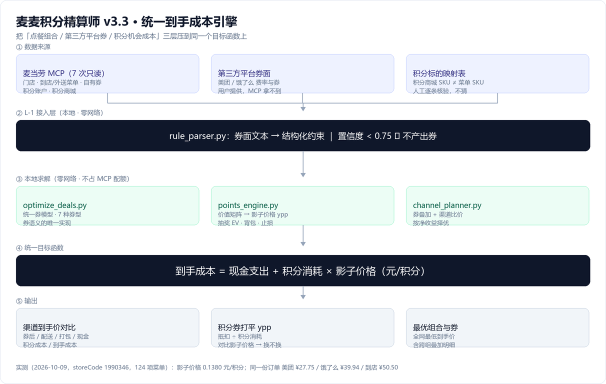
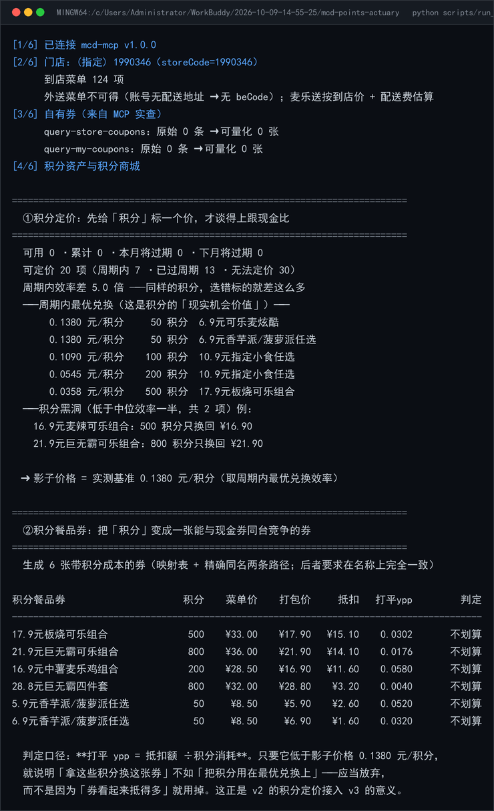
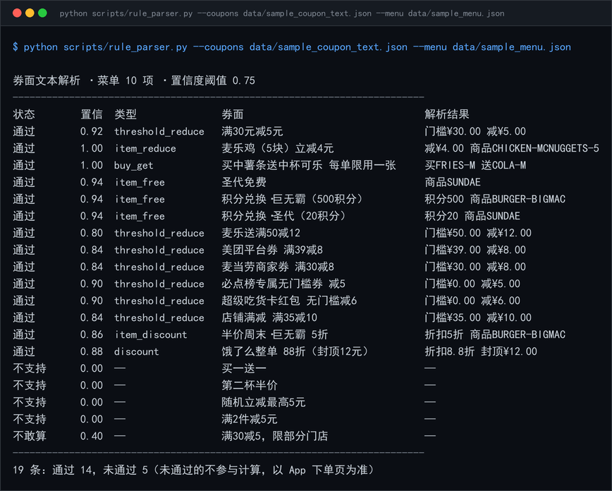
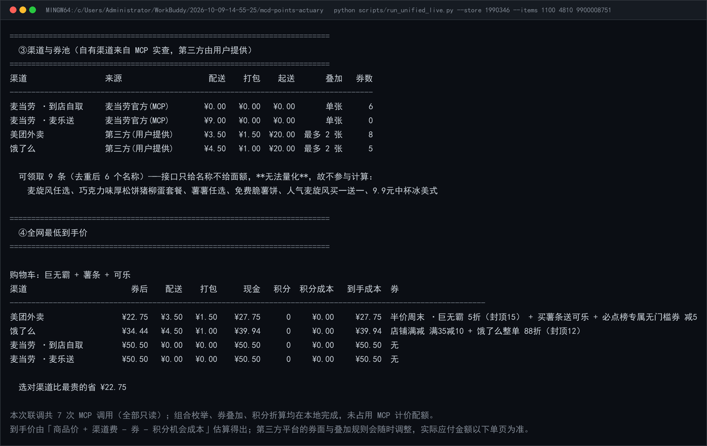
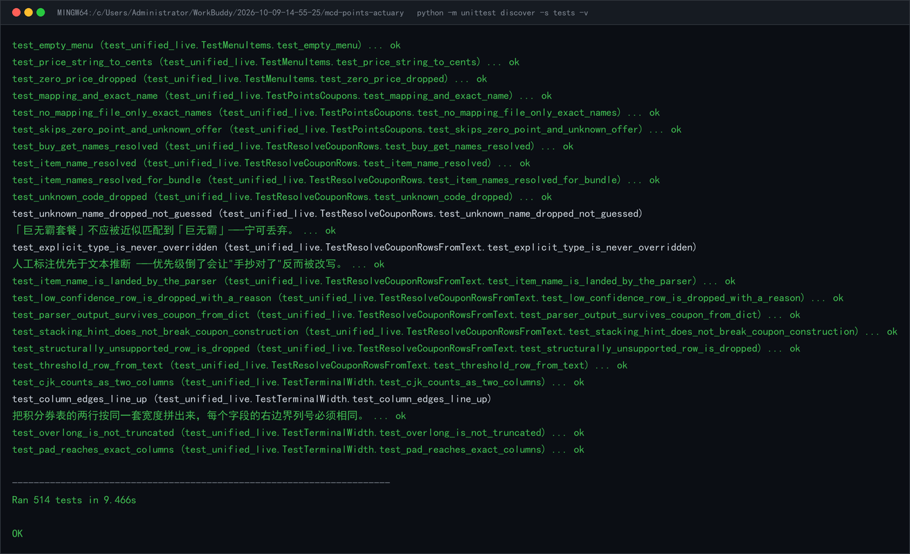

# 麦麦积分精算师 · MCD Points Actuary

> 点外卖这件事，**钱**已经有很多工具在算，**积分**几乎没人算。
> 本项目把「渠道费 / 券叠加 / 积分机会成本」折算到**同一个目标函数**上，
> 回答一句以前没人算得清的话：**这单到底在哪买、用哪张券、要不要动积分，到手最便宜？**

[](https://open.mcd.cn/mcp)
[](https://www.python.org/)
[](tests/)
[](LICENSE)

---



> 上图四个阶段的**相邻两层之间没有网络调用**：7 次只读 MCP 取数之后，
> 组合枚举、券叠加、积分折算全部在本地完成，不占用 MCP 计价配额。

## 一句话价值

同一份订单 —— **巨无霸 + 薯条 + 可乐**，在麦当劳南京新百餐厅（`storeCode=1990346`）实查菜单下：

| 渠道 | 券后商品 | 配送 | 打包 | 实付现金 | 用到券 | 到手成本 |
|---|---|---|---|---|---|---|
| **美团外卖** | ¥22.75 | ¥3.50 | ¥1.50 | ¥27.75 | 半价周末·巨无霸 5折 + 买薯条送可乐 + 必点榜减5 | **¥27.75** |
| 饿了么 | ¥34.44 | ¥4.50 | ¥1.00 | ¥39.94 | 店铺满35减10 + 整单88折 | ¥39.94 |
| 麦当劳 · 到店自取 | ¥50.50 | ¥0.00 | ¥0.00 | ¥50.50 | 无 | ¥50.50 |
| 麦当劳 · 麦乐送 | ¥50.50 | ¥0.00 | ¥0.00 | ¥50.50 | 无 | ¥50.50 |

**选对渠道 + 选对券，比最贵的组合省 ¥22.75（−45%）。** 而这还没算积分那一层 —— 见下。

## 统一目标函数

三层变量（渠道 × 券 × 用现金还是用积分）被压到**一个式子**上：

```text
到手成本 = 现金支出 + 积分消耗 × 积分影子价格（元/积分）
```

**关键在于「积分影子价格」不是拍脑袋设的常数**，而是由积分商城实测算出来的 ——
"这些积分拿去做最优兑换，能保证换回多少现金"。它让"花 500 积分省 24 元"
这类决策第一次可以被判定为**亏损**，而不是凭感觉。

真实积分商城的实测结果（2026-10-09）：周期内最优兑换 **0.1380 元/积分**，最差 **0.0274**。

### 一个数不够：影子价格要**并列三种口径**

0.1380 是"积分商城里最划算的那一档"，**不是"你手上这些积分"的价值**。把两者混为一谈，
会系统性高估积分、把本来划算的抵扣误判成亏损。所以本项目不再只给一个数，而是并列摆出三档，
每一档都写清楚**它是怎么算的、什么时候该用**：

| 口径 | 定义 | 怎么算 | 该在什么时候用 |
|---|---|---|---|
| **最优标的效率** | 周期内效率最高的那件标的 | `max(面值 ÷ 积分)` | **主口径**，对外公布、跨期可比；刻意保守，杜绝"积分不值钱"的过度乐观 |
| **保守分位（P25）** | 历史各期最优效率的 25% 分位 | `shadow_price.py` 时间序列 | 历史攒够多期后，给出"至少不会比这更差"的下界；样本不足时**明确降级**而不是假装有 |
| **余额处边际效率** | 在**你的余额**处，最后一份积分还能换回什么 | 有界背包在余额处的边际值 | 判断"这一单该不该花积分" —— 它才是这笔决策的机会成本 |

> **主口径仍然是 0.1380，本文与对外数字一律以它为准**；保守分位与边际效率**并列展示**，
> 用于说明结论的适用边界，不改动任何已公布的结论。

### 为什么必须并列：0.1380 会在余额偏大时高估 100%

原因很朴素 —— **最优标的是限量的**。「50 积分换 6.9 元派」每人每月通常只能换 1 次，
换完之后下一档是 0.1090、再下一档 0.0358……所以 0.1380 只对**最前面那几十个积分**成立。

`expiry_policy.py` 把这个"效率断崖"直接算出来（有界背包的精确解，不是估的）：

```text
余额 1500 积分 · 距到期 36 天

影子价格（这是本模块的核心产出）：
  最优标的效率（v3 现用口径）  0.1380 元/积分   ← 只对最前面那几十个积分成立
  余额处平均效率               0.0594 元/积分   ← 全部积分摊平后的真实产出
  余额处**边际**效率 ← 建议用  0.0000 元/积分   ← 最后一份积分还能换回什么
  现用口径的高估幅度           0.1380 元/积分（100.0%）

有效兑换容量 1300 积分（再多积分也换不出更多价值）· 死积分 200 积分
```

同一套代码在余额 50 积分时，三档全部等于 0.1380（高估幅度 0.0%）—— 差异从哪来、
什么时候来，是可复算的，不是话术。

于是下面这张表可以被算出来：

| 积分餐品券 | 所需积分 | 菜单单点价 | 打包价 | 抵扣 | **打平 ypp** | 判定 |
|---|---|---|---|---|---|---|
| 17.9元板烧可乐组合 | 500 | ¥33.00 | ¥17.90 | ¥15.10 | 0.0302 | ❌ 不划算 |
| 21.9元巨无霸可乐组合 | 800 | ¥36.00 | ¥21.90 | ¥14.10 | 0.0176 | ❌ 不划算 |
| 16.9元中薯麦乐鸡组合 | 200 | ¥28.50 | ¥16.90 | ¥11.60 | 0.0580 | ❌ 不划算 |
| 28.8元巨无霸四件套 | 800 | ¥32.00 | ¥28.80 | ¥3.20 | 0.0040 | ❌ 不划算 |

> **打平 ypp = 抵扣额 ÷ 积分消耗。** 只有它**低于**影子价格（主口径 0.1380），用这张券才亏。
> 上表 6 张券全部远低于基准 —— 结论很反直觉：**积分商城里"抵得最多"的券，恰恰是最不该换的**。

终端里的真实样子（含 ①积分定价 与 ②积分券打平线 两段，原始输出见
[`docs/captures/unified-live.txt`](docs/captures/unified-live.txt)）：


> 同样的券，如果你有积分即将过期（`--shadow-ypp 0`，视为沉没成本），立刻全部变成划算。
> 两种口径的差异，就是"积分到期前该不该突击兑换"的量化答案。

## 四层能力叠在一起

| 层 | 回答 | 引擎 | 在统一目标函数里的角色 |
|---|---|---|---|
| **L-1 · 接入** | 券面文字怎么变成规则？ | `rule_parser.py` | 把「满30减5」「半价周末」这类**文本**转成结构化约束；置信度不足就**不介入** |
| **L0 · 执行** | 算得快不快？问得多不多？ | `combo_search.py` + `mcp_cache.py` | 剪掉注定赢不了的组合；同一份数据不重复问 |
| **L1 · 点餐组合** | 买哪几件？ | `optimize_deals.py` | 枚举候选组合 + 券语义唯一实现 |
| **L2 · 积分资产** | 积分值多少钱？ | `points_engine.py` | 产出 `影子价格 ypp`，给"积分"标价 |
| **L3 · 渠道 × 券** | 在哪买？用哪张券？ | `channel_planner.py` | 把三层折到同一个 `到手成本` 上 |

**L2 是 L3 的度量基础**：没有影子价格，渠道比较只能比现金，"要不要用积分"永远算不清。
**L1 是 L3 的候选来源**：渠道价差几乎全部来自券，所以候选池按"券能生效的商品"构造。
**L0 是 L1–L3 的成本底座**：两者都**不允许改变答案**，只允许少算、少问 —— 由对拍测试守着。
**L-1 是 L1–L3 的输入闸门**：它只做一件事 —— 把文本变成约束，**变不动的就不放进来**。
宁可少一张券，也不要一张读错的券：少一张顶多错失优惠，读错一张会给出一个买不到的价格。

## 工作流（全程 7 次 MCP 调用；重复运行降为 0 次）

```text
① query-nearby-stores   → 门店（默认选营业中、距离最近）
② query-meals ×2        → 到店菜单 + 外送菜单（外送需 beCode，取不到则降级并声明）
③ query-store-coupons   → 门店可用券（到店）
   query-my-coupons     → 我的券
   available-coupons    → 可领取券（接口只给名称，列为"未建模"，不猜测面额）
④ query-my-account      → 积分账户（到期提醒）
   mall-points-products → 积分商城 → 价值矩阵 → 影子价格

   ── 以下全部在本地完成，不占 MCP 配额 ──
   券面文本解析（无 type 的券行）→ 券叠加求解 → 全渠道组合枚举 → 到手成本排序 → 报告
```

真实响应里 `structuredContent` 已含服务端预解析的 JSON，客户端优先走这条路径，
比从"说明文字 + JSON"里正则捞取稳健得多（旧版本自动回退到文本提取）。

上面这 7 次调用走的是 `mcp_cache.py` 的 TTL 缓存：**同一份数据在有效期内不再问第二次**，
所以第二次运行同一条工作流是 **0 次 MCP 调用**。缓存不会把失败载荷写进去 ——
一个 `{"error": ...}` 被缓存 30 分钟，比不缓存糟糕得多。

## 九个数学内核

| 内核 | 回答 | 做法 |
|---|---|---|
| 价值矩阵 | 同样积分换什么最值？ | `ypp = 面值 ÷ 积分`，中位数识别陷阱，周期冲突降级为"待复核" |
| 抽奖期望 | 该换券还是抽奖？ | **零概率信息下的分层夹逼**（见下） |
| 券叠加 | 这堆券怎么组合最优？ | 同 `stack_group` 互斥、跨组叠加、按**净收益**择优、整单券限张数 |
| 到手成本 | 在哪买最便宜？ | 全渠道枚举 × 预算按"到手成本"判定，而非券后商品价 |
| **券面解析** | **一堆文字券怎么进模型？** | **七种券型的模式匹配 + 逐条可复核的置信度；不够格就不产出券**（见下） |
| **组合剪枝** | **池子大到枚举不完怎么办？** | **按价格升序建搜索树 + 可采纳下界，把"再涨也赢不了"整棵砍掉**（见下） |
| 约束求解 | 券的组合多到枚举不完怎么办？ | 表成 C1–C4 约束，**分支定界求精确解**，规模过大退化为束搜索并**标注方法** |
| 影子价格时间序列 | 这个价格稳不稳？ | 每期快照入档，按窗口取保守分位；样本不足就**降级**并说出来 |
| 跨期序贯策略 | 拖着晚点换行不行？ | 有界背包的精确解 + 逐点边际曲线，给出**有效兑换容量**与"最晚开始日" |

### 亮点：MCP 不返回中奖概率，怎么判断抽奖划不划算？

`query-lottery-info` 只给奖品名称，**不给概率**。常规做法只能"猜"，本项目改用**分层夹逼**，
让每个结论都带上它的成立条件：

| 判定 | 成立条件 | 含义 |
|---|---|---|
| `dominated` | `奖池最高单项 < 打平线` | **必亏**，不需要任何概率假设 |
| `robust` | 假设「永不上头奖、其余等概率」仍划算 | 结论**不依赖**头奖命中率 |
| `likely` | 全奖池等概率期望达标 | 倾向抽，但依赖头奖命中率 |
| `depends` | 仅当头奖命中率 ≥ p 才划算 | **反解出一元不等式**给出精确门槛 |

打平线 = 单次消耗积分 × 影子价格 —— 即"这些积分拿去兑换能保证拿到的价值"。

**分层夹逼给的是"边界"，`lottery_mc.py` 再补上"分布"**：在四种概率假设下各跑 2 万次
定点模拟（固定种子，可原样复现），除均值外还给出**亏损概率**与分位数：

```text
══ 跨概率假设压力测试（20,000 次 × 33 抽，种子 20261009）══
假设             均值/抽      实测 ypp   单次亏损概率   合计亏损概率
uniform            ¥8.20   0.3418 元/积分       37.9%         0.0%
pessimistic        ¥6.92   0.2882 元/积分       43.2%         0.0%
long_tail          ¥4.56   0.1900 元/积分       67.4%         7.0%
optimistic        ¥13.09   0.5454 元/积分        9.3%         0.0%
```

均值稳稳高于打平线 ¥3.31，**但单次亏损概率最高到 67.4%** ——
"期望值为正"和"这一抽不会亏"是两回事。均匀与悲观两种假设**有闭式解**，
蒙特卡洛均值必须与它对上（差 3 分左右，抽样误差内），这是唯一能证明"模拟没写错"的硬校验。

### 亮点：券叠加不再靠"逐张贪心"，而是解一个约束问题

v3 的券叠加是"逐张试、留更优"的贪心。它在**商品池**这一层会算错。最小反例：

```text
购物车：A ¥10 + B ¥10
可用券：「A 单品5折」(互斥组 g1) + 「A 免单」(互斥组 g2)

旧实现：抵扣 ¥15.00 → 应付 ¥5.00    ← 错：把 A 抵成负数，多出的 ¥5 记到 B 头上
新实现：抵扣 ¥10.00 → 应付 ¥10.00   ← 对：A 一共只值 ¥10
```

`coupon_solver.py` 把问题显式表成四条约束，而不是继续打补丁：

| 约束 | 含义 |
|---|---|
| **C1 组内互斥** | 同一 `stack_group` 只能有一张生效（空组视为同一默认组） |
| **C2 整单券限张** | `max_stack` 限制整单级券张数；单品级属平台定价，不占额度 |
| **C3 商品池** | 每件商品**被抵扣总额 ≤ 标价** —— 就是上面那个反例 |
| **C4 适用条件** | 门槛、商品范围、张数上限 |

规模小时**分支定界求精确解**（结果里标 `method=exact`，附带剪枝前后节点数）；
规模超限自动退化为束搜索，并把 `method=beam` **写进结果** —— 用了近似就说用了近似。
与旧实现对拍 **2548 组购物车 × 4 档影子价格 = 0 处不一致**（在旧实现本就正确的问题上），
而上面那个反例被单独钉成回归用例。引擎通过 `apply_coupons(..., engine=...)` 切换，
**默认仍是旧引擎**，所以已公布的任何数字都不会因为这次重构而移动。

### 亮点：剪枝不是"少算点"，而是"证明剩下的没必要算"

全渠道求解要枚举候选池的 k 元组合。样例池 10 项、k≤5 只有 637 个组合；换成全菜单
（60+ 项）允许 4 件，就是 52 万个 —— 而**绝大多数注定赢不了**。

`combo_search.py` 把组合空间组织成一棵**按价格升序**的搜索树，边走边算
「这个前缀再怎么加也赢不了」，然后整棵砍掉：

```text
到手成本 ≥ 商品小计 × 最小标价系数 − 取整余量 − 抵扣上界 + 最小打包费
```

等式右边每一项都**小于等于**真实值（抵扣上界按互斥组取最大再求和；积分机会成本与
配送费都按 0 算），所以它是**可采纳下界**。商品小计沿子树只增不减 ⇒ 一个孩子一旦越过阈值，
**它的所有后代**同样出局。安全性依赖三条，测试里各自单独钉住：下界可采纳、下界对小计单调不减、
只有前 N 名**已满**时才启用阈值（否则会拿"只有 2 个结果"的边界去剪）。

实测（`tools/bench.py`，全部可复跑）：

| 场景 | 枚举量 | 耗时（中位） | 省下 | 内存峰值 | 结果一致 |
|---|---|---|---|---|---|
| 样例池 10 项，k≤5 | 637 → **184** | 36.07 → **9.96 ms**（3.62×） | 71.1% | 79 → **25 KiB** | 是 |
| 合成池 22 项，k≤4 | 9,108 → **1,114** | 463.3 → **52.4 ms**（8.84×） | 87.8% | 2115 → **256 KiB** | 是 |

> 「结果一致」不是形容词：同一份输入跑 `full` 与 `pruned` **逐字段比对**，
> 另有独立写的暴力枚举当第三方裁判。

**过程中真的踩到一个会静默剪错最优解的坑**，值得写出来：

```text
引擎是两段式的：单品级券先落地 → 整单级券作用于剩余金额
「到店自取」的默认组里同时挂着一张 item_free 和一张 threshold_reduce

按 stack_group 取最大值（错）：950 分
真实能拿到的抵扣（对）：    950 + 500 = 1450 分
```

`stack_group` 只表达"同组互斥"，**不含**单品级/整单级这个维度 —— 两张同名组但不同阶段的券
会**同时生效**。上界一旦低于真实抵扣，下界就被抬高，最优解会被**静默剪掉**。
修法是让上界按引擎的真实两段结构分开估；顺带按 `allow_stack` / `max_stack` 收紧，
剪枝率因此从 63.9% 提到 71.1%（k≤5）。修完还发现第二个问题：剪枝只保留前 N 条，
成本打平时**边界上的并列者**取决于各自枚举顺序，于是两个引擎会各挑一个
"同样便宜但不同"的方案 —— 排序键因此补成**全序**（成本 → 件数 → 池内下标元组）。

这两条现在各有一个专门的测试类守着（`TestDiscountCeilingMixedStage`、
`TestEngineSelection.test_ties_are_broken_deterministically`）。

### 亮点：MCP 缓存 —— 快是次要的，别把失败缓存起来才是主要的

缓存最容易"看起来在工作"：它确实返回了数据、确实比每次打接口快 —— 但可能返回**过期数据**，
或者把一次**失败**缓存成一小时都修不好的脏条目。所以 `mcp_cache.py` 的重点不在命中率：

- **按工具分档 TTL**（菜单 30 min / 门店 10 min / 券 5 min / 账户 1 min），每档都写清为什么是这个量级；
- **失败与空载荷绝不入缓存** —— `{"error": ...}` / `{"code": 40x}` / 空列表一律放行到网络；
- **命中率分成"本次运行"与"累计"两个数**，同时报"逻辑调用"与"真实网络调用"；
  混在一起说就是在给自己发奖状；
- 条目**损坏就删掉**再回源，而不是反复读一个坏 JSON。

效果：同一条工作流第二次运行是 **0 次 MCP 调用**。

### 亮点：微优化 —— 有一条我测完决定不拿它当论据

`tools/bench.py` 把三类改动逐项拆开测，每项都给出对照实现。其中一条结论是**负面**的：

| 改动 | 实测 | 结论 |
|---|---|---|
| `math.comb` 替掉手写循环 | 4~5×（每次省 0.5 µs） | **微秒级，不该拿它当性能论据** —— 全项目只调用 ≤5 次 |
| 约束检查用位掩码随递归传递 | 3~4×（每个叶子省一次建 set） | 值得：叶子上万时是实打实的常数 |
| `@dataclass(slots=True)` | 对象 + `__dict__`：344 B → 80 B | 摊到"每对象实测"只省 40 B（字段内容两边都要分配）—— 两个数一起报 |

`math.comb` 那条值得做（不写循环、不用自己处理 `k>n` 的边界），但它省下的时间占一次
全渠道求解不到万分之一。**把一条改动的收益说成它实际的样子**，比把三条都写成"大幅提升"
更接近工程。

### 亮点：券面文本解析 —— 一条"宁可不算，也不猜算"的流水线

v1~v3.2 的券都是**人手抄进 JSON 的结构化行**。这在演示里没问题，一碰真实数据就崩：
券面长这样 —— 「满30元减5元」「麦乐鸡（5块）立减4元」「半价周末·巨无霸 5折」
「必点榜专属无门槛券 减5」「饿了么整单 88折（封顶12元）」。**它们都是文本**，
字段是人读出来的，不是程序读出来的。而**抄错一个门槛**（把"满39"写成"满29"）
会让整条决策链算出一个买不到的"最便宜"，比不做还糟。

所以 `rule_parser.py` 不是一条"能解析就解析"的流水线，而是一条**带闸门**的流水线：

```text
                         ┌─ 结构不支持（refused）──→ 大声说出来，并说明模型边界在哪
券面文本 ─→ 尾部说明切分 ─→ 模式匹配 ─→ 置信度打分 ─→ 闸门 0.75 ─┬─ 通过 ─→ 结构化字段
                         └─ 置信度不足（ambiguous）─→ 不产出券，以 App 下单页为准
```

三条设计原则，每条都在测试里钉住：

1. **宁可不算，不可猜算。** 低于阈值的结果**不产出 `Coupon`**（`fields` 直接清空），
   而不是产出一张"低分券"—— 后者会让调用方有机会"顺手用一下"，闸门就白设了。
2. **置信度是算出来的，不是拍出来的。** 分数由一串带**原文位置**与原因的
   `Evidence` 加出来，可逐条复核：

   ```text
   原文：半价周末·巨无霸 5折
   结论：已解析为 item_discount（置信度 0.86）
     +0.60  结构          '5折'@9:11  —— 折扣
     +0.20  关键量齐全       ''  —— 折后比例 0.5
     +0.04  交叉印证        '半价 + 5折'  —— 两处独立陈述一致
     +0.14  商品定位        "['半价周末', '巨无霸'] → BURGER-BIGMAC"  —— 唯一命中，判为**单品折扣**
     -0.12  无封顶         ''  —— 文本没写封顶：按不封顶估算会高估优惠
   文本未给出（不推断，交调用方）：封顶额（cap）、门槛（threshold）、stack_group（互斥组）
   ```

3. **绝不推断文本没写的东西。** 封顶、门槛、互斥组这些文本里根本不存在的字段，
   一律记进 `unstated` 交给调用方，不替平台"补全"规则。

**「结构不支持」与「不敢确定」必须分开报。** 前者是模型边界（文本清清楚楚，只是装不下），
后者是信息不足。混在一起会让人以为"这个项目不支持券"：

| 券面 | 判定 | 为什么 |
|---|---|---|
| 第二杯半价 / 买一送一 | refused | 需要**同一商品多份**，而购物车是**集合**，表达不了份数 |
| 满2件减5元 | refused | 件数门槛，v3 的门槛只有金额口径 |
| 随机立减最高5元 | refused | 优惠额是**随机变量**；要纳入应取**保守分位**而非期望值 |
| 满30减5，限部分门店 | ambiguous | 券在不在**本店**可用，文本读不出来 ⇒ 一律按不可用 |
| 买中薯条送中杯可乐 每单限用一张 | **通过** | 频次限制不改变"这一单省多少"，拒绝它等于白扔一张算得对的券 |

最后一行是关键取舍：**闸门要拦的是"算错"，不是"看不懂"**。所以「每单限用一张」
不但通过，还会附一个 `_stack_hint=single` 的结构提示给下游（长期策略需要"能用几次"）。

跑真实数据（`data/sample_coupon_text.json`，19 条手抄券面）：
**14 条通过、4 条结构不支持、1 条置信度不足**，退出码 = 未通过条数，可直接接 CI。



```text
$ python scripts/rule_parser.py --coupons data/sample_coupon_text.json --menu data/sample_menu.json
通过        0.92  threshold_reduce   满30元减5元                         门槛¥30.00 减¥5.00
通过        1.00  buy_get            买中薯条送中杯可乐 每单限用一张     买FRIES-M 送COLA-M
通过        0.86  item_discount      半价周末·巨无霸 5折                 折扣5折 商品BURGER-BIGMAC
通过        0.88  discount           饿了么整单 88折（封顶12元）         折扣8.8折 封顶¥12.00
不支持      0.00  —                  第二杯半价                          —
不敢算      0.40  —                  满30减5，限部分门店                 —
19 条：通过 14，未通过 5（未通过的不参与计算，以 App 下单页为准）
```

> 接入方式：`run_unified_live.resolve_coupon_rows` 遇到**没有 `type` 的行**就会先过一遍
> 解析层；解析不通过的直接丢弃并附原因。有 `type` 的行**完全不走这条路** ——
> 人工标注优先于文本推断，这个优先级不能倒。实测接入后离线全流程输出**逐字节不变**。

### 对拍真实数据时发现的事：文本的信息量**小于**结构化行

把 17 条真实券面解析出来，与 `data/sample_channels.json` 里人工标注的结构化行逐字段对拍，
大部分完全一致，但有两处**必然**对不上：

| 券面 | 人工标注 | 文本能推出来的 | 差在哪 |
|---|---|---|---|
| 半价周末·巨无霸 5折 | `cap = 15.0` | 无封顶 | 文本里**没有封顶** |
| 饿了么整单 88折（封顶12元） | `threshold = 30.0` | 门槛 0 | 文本里**没有门槛** |

这不是解析器的 bug，是**这两张券的文字确实没写全**。而这两个字段都是**乐观**方向：

- `discount` 的 `threshold_cents` 留 0 ⇒ 券变成"无条件可用"，从"可能打折"变成"必打折"；
- `cap_cents` 留 0 ⇒ 折扣没有上界。

所以解析层把它们写进 `unstated`，**并因此把「全场8折」这类无封顶折扣券拦在闸门外**
（置信度 0.70 < 0.75）。这条结论比"我解析对了多少条"更有价值：
**文本解析永远只能是入口，替代不了人工标注** —— 代码把这件事说出来了，而不是假装没看见。

## 核心特性

- 🎯 **一个目标函数管三层**：渠道费、券叠加、积分机会成本统一折算
- 🧭 **积分定价让"该不该用券"可判定**：算出每张券的**打平影子价格**，一句话给结论
- 📐 **影子价格三档并列**：最优标的效率（主口径 0.1380）/ 历史保守分位 / **你余额处的边际效率**
  —— 余额 1500 时前者高估 100%，差异是算出来的，不是话术
- 🧱 **券叠加显式建模**：单品级先落地 → 整单级按余额判定 → 同组互斥、跨组叠加、限张数
- 🧮 **券组合是约束求解，不是贪心**：C1–C4 四条约束 + 分支定界精确解，方法（exact/beam）写进结果
- ⚡ **组合枚举是可采纳下界剪枝**：样例池 k≤5 省 **71.1%** 枚举量（3.62×），
  22 项合成池省 **87.8%**（8.84×），且与全量枚举**逐字段一致**
- 🗃️ **MCP 有 TTL 缓存**：按工具分档过期、失败载荷绝不入缓存、命中率分"本次/累计"报；
  同一条工作流第二次运行是 **0 次 MCP 调用**
- 📊 **性能改动都带可复跑的数字**：`tools/bench.py` 逐项给对照实现 ——
  包括一条"这条优化太小、不该拿它当论据"的负面结论
- 🔤 **券面文本 → 结构化约束，且带闸门**：七种券型可解析（满减 / 单品立减 / 免单 / 买赠 /
  折扣 / 单品折扣 / 组合特价）；置信度由**逐条带原文位置的证据**加出来，不够格就**不产出券**
- 🚧 **「结构不支持」与「不敢确定」分开报**：「第二杯半价」要的是同一商品两份，
  购物车是集合装不下；「限部分门店」是本店能不能用读不出来 —— 两种拒绝，两种话术
- 🛡️ **拒绝模糊推断**：积分商城 SKU 与菜单 SKU 不一致时**丢弃而非猜测**
  （实测「18.8元板烧鸡腿堡**两件套**」会被错配到菜单「板烧鸡腿堡**三件套**」）
- 🕳️ **积分黑洞预警**：给出每个低效标的的机会成本金额
- ⏳ **跨期序贯策略**：有界背包精确解 → **有效兑换容量**、死积分数量、**最晚开始日**、
  建议日均消耗速率；"再拖 20 天会少挽回多少"是可算的
- 🎲 **抽奖给出分布而不只是期望**：四档概率假设 × 2 万次定点模拟，输出**亏损概率**与分位数
- 🗂️ **影子价格入档**：每期快照存 `data/shadow_price_history.json`，历史不足时**明确降级**，不假装有
- 🧾 **金额全程以「分」整数计算**，无浮点误差
- 🔌 **离线可测 + 离线可跑**：514 项单元测试全绿；`--offline` 无需 Token 即可复现全流程
- 🚦 **限流友好**：全流程 MCP 调用次数为**个位数**

## 目标用户

| 人群 | 痛点 | 本 Skill 的价值 |
|---|---|---|
| 点外卖的麦麦会员 | 到店/麦乐送/美团/饿了么，不知道哪边便宜 | 直接给各渠道到手价对比与最优选择 |
| 手上一堆券的人 | 平台券 + 商家券 + 必点榜券，不知道能不能叠 | 按声明口径求解最优券组合 |
| 攒了积分的人 | 积分躺在账户里，不知道换什么 | 全量价值矩阵 + 黑洞清单 + 最优兑换组合 |
| 收到"积分将过期"提醒的人 | 知道要过期，不知道该换什么止损 | 最快的消耗路径 + 剩余损失金额 + 沉没成本口径的决策 |
| 爱抽奖的用户 | 不知道抽奖是不是在烧积分 | 给出抽与不抽的判定条件 |

## 安装方法

### 1. 申请麦当劳 MCP Token

访问 <https://open.mcd.cn/mcp> → 右上角「登录」（手机号验证）→「控制台」→「激活」→ 复制 Token。

### 2. 配置 MCP 连接器

将 `mcp-config.example.json` 中的 `${MCD_MCP_TOKEN}` 替换为实际 Token，填入你的 MCP Client（WorkBuddy / Cursor / Cherry Studio / Trae 等）：

```json
{
  "mcpServers": {
    "mcd-mcp": {
      "type": "streamablehttp",
      "url": "https://mcp.mcd.cn",
      "headers": { "Authorization": "Bearer YOUR_MCP_TOKEN" }
    }
  }
}
```

### 3. 设置环境变量（脚本层需要）

```bash
export MCD_MCP_TOKEN=你的Token        # Linux / macOS / Git Bash
setx MCD_MCP_TOKEN 你的Token          # Windows（需重开终端）
```

### 4. 运行

```bash
git clone https://github.com/akexin/mcd-points-actuary.git
cd mcd-points-actuary
python -m unittest discover -s tests        # 118 项离线自检
python scripts/run_unified_live.py --offline  # 无需 Token 复现全流程
```

> 无需 `pip install`：本项目只依赖 Python 标准库。

## 使用示例

### 示例 A · 统一联调（真实 MCP，本项目的入口）

```bash
export MCD_MCP_TOKEN=你的Token
python scripts/run_unified_live.py --city 南京市 --keyword 新街口
python scripts/run_unified_live.py --store 1990346 --items 1100 4810 9900008751
python scripts/run_unified_live.py --store 1990346 --shadow-ypp 0   # 积分即将过期
```

真实运行输出（2026-10-09，麦当劳南京新百餐厅 `1990346`）：



上图是**原样渲染**的真实 stdout —— ③ 列出各渠道费率与券数，④ 给出四个渠道的到手价对比。
输出里处处留着可复核的诚实标注：`外送菜单不可得 … 按到店价估算`、
`可领取 9 条（去重后 6 个名称）… 无法量化，故不参与计算`、
以及末尾那句 `实际应付金额以下单页为准`。

逐字原文与复现命令：[`docs/captures/unified-live.txt`](docs/captures/unified-live.txt)
（74 行，由上表那条命令**原样重定向**得到）；配图由
[`tools/make_readme_assets.py`](tools/make_readme_assets.py) 从该文件渲染 ——
所以改一个数字，图就跟着变，不存在"图和代码对不上"的可能。

### 示例 B · 离线体验（不需要 Token）

```bash
python scripts/run_unified_live.py --offline
python scripts/points_engine.py matrix --products data/sample_points_products.json
```

积分价值矩阵输出（节选，真实商城数据脱敏快照）：

```text
可定价标的 20 项（周期内 7 · 已过周期 13 · 无法定价 4）
中位效率 0.0695 元/积分
效率倍数差：全库 13.7 倍 | 周期内 5.0 倍
 1.    0.3760 元/积分     50 积分  18.8元麦辣鸡腿汉堡两件套  ← 已过周期·待复核
 4.    0.1380 元/积分     50 积分  6.9元可乐麦炫酷
20.    0.0274 元/积分    800 积分  21.9元巨无霸可乐组合  ← 陷阱
```

### 示例 C · 抽奖到底划不划算

```bash
python scripts/points_engine.py lottery \
  --lottery data/sample_lottery.json --products data/sample_points_products.json \
  --refs data/sample_reference_prices.json
```

```text
单次消耗 24 积分 | 兑换基准 0.1380 元/积分
打平直接兑换所需期望价值：¥3.31
  最高单项 ¥17.25 | 最低 ¥1.00 | 全池等概率期望 ¥8.24 | 悲观期望 ¥6.95
判定：抽奖占优 —— 结论不依赖头奖命中率（ROBUST）
```

### 示例 D · 积分资产诊断

```bash
python scripts/run_points_live.py --city 南京市 --keyword 新街口 --points 1500 --expiring 800
```

```text
【800 积分即将过期，止损方案】
  ① 兑换挽回 ¥92.10：18.8元麦辣鸡腿汉堡两件套 + … + 16.9元中薯麦乐鸡组合
  ② 余额抽奖 6 次（144 积分，按基准折价 ¥19.87）
  合计挽回 ¥111.97
  ⚠ 仍有 6 积分无法消耗，预计损失 ¥0.83
```

### 示例 E · 影子价格的历史与保守分位

```bash
python scripts/shadow_price.py report
```

```text
  共 1 条快照：
    2026-10-10  门店 1990346    最优 0.1380  中位 0.0695  最差 0.0274  （周期内 7 项）

  口径                           建议值
    最新实测（主口径）     0.1380 元/积分  ← 主口径：对外公布、跨期可比，刻意偏保守
    保守分位（近窗 P25）   0.1380 元/积分  ← 下界：历史攒够多期后才与主口径分叉

  主口径 0.1380 · 保守 P25 0.1380 · 区间 [0.1380, 0.1380] · 样本 1 次 · 窗口 6
  历史样本仅 1 次（<6 次窗口要求）→ 保守分位退化为单点值，**不假装有历史**
```

> 样本只有 1 条时它**明说自己退化了**，而不是拿单点冒充"历史区间"。
> 每跑一次 `run_unified_live.py --record-shadow` 就往 `data/shadow_price_history.json`
> 入档一条（按「门店+日期」去重，同日重复跑不会堆垃圾数据）。
> 攒够一个窗口之后，两个口径才真正分叉 —— 分叉的那一天，保守值会自己出现。

### 示例 F · 到期前的序贯兑换策略

```bash
python scripts/expiry_policy.py --balance 1500 --expiry 2026-11-15
```

```text
余额 1500 积分 · 距到期 36 天（2026-11-15）

建议兑换 5 类、共 9 次：
  6.9元香芋派/菠萝派任选 × 2  → 花   100 积分换回 ¥13.80（单件 0.1380 元/积分）
  6.9元可乐麦炫酷 × 2  → 花   100 积分换回 ¥13.80（单件 0.1380 元/积分）
  10.9元指定小食任选 × 2  → 花   200 积分换回 ¥21.80（单件 0.1090 元/积分）
  10.9元指定小食任选 × 2  → 花   400 积分换回 ¥21.80（单件 0.0545 元/积分）
  17.9元板烧可乐组合 × 1  → 花   500 积分换回 ¥17.90（单件 0.0358 元/积分）

合计：花 1300 积分 · 挽回 ¥89.10 · 余 200 积分 · 相对最优解少拿 ¥0.00
建议日均消耗 36.1 积分

影子价格（这是本模块的核心产出）：
  最优标的效率（v3 现用口径）  0.1380 元/积分   ← 只对最前面那几十个积分成立
  余额处平均效率               0.0594 元/积分   ← 全部积分摊平后的真实产出
  余额处**边际**效率 ← 建议用  0.0000 元/积分   ← 最后一份积分还能换回什么
  现用口径的高估幅度           0.1380 元/积分（100.0%）
  前向：再攒一份能多换回       0.0020 元/积分   ← 手上的分已换不完，别再攒

有效兑换容量 1300 积分（再多积分也换不出更多价值）· 死积分 200 积分

最晚开始日：2026-10-15（5 天后，还有 36 天到期）
```

> 两个名字很像的「10.9元指定小食任选」是**两条不同的标的**（100 分 / 200 分），
> 所以清单里它们分开列 —— 按名称合并会把结论改掉，这一条有专门的回归测试守着。
> `最晚开始日` 也不是拍出来的：它是对「每期可兑换次数被到期日截断」做扫描求出来的
> —— 再拖下去，可挽回金额会真的下降。

### 示例 G · 券组合的约束求解与两套口径

```bash
python scripts/coupon_solver.py --items data/sample_menu.json \
  --channels data/sample_channels.json --channel meituan \
  --cart BURGER-BIGMAC BURGER-DOUBLE-CHEESE CHICKEN-MCNUGGETS-5 --shadow-ypp 0.138
```

```text
  渠道：美团外卖（券 6 张，可叠加 ≤ 2 张）
  购物车：巨无霸 + 双层吉士汉堡 + 麦乐鸡（5块） = ¥52.50

  ── order_mode=middle ──
    方法 exact · 单品级展开 2/2 状态（剪掉 0.0%）· 整单级试算 2 次
      半价周末·巨无霸 5折（item_discount）→ ¥12.25
      美团平台券 满39减8（threshold_reduce）→ ¥8.00
      麦当劳商家券 满30减8（threshold_reduce）→ ¥8.00
    抵扣 ¥28.25 · 积分 0 · 应付 ¥24.25 · 净收益 ¥28.25
    商品池占用：巨无霸 ¥12.25
```

> 「商品池占用」这一行就是约束 **C3** 的可视化：巨无霸一共只被抵了 ¥12.25（它标价的一半）。
> 两套整单级口径并列输出 —— `middle`（都在扣掉单品级优惠后的同一个余额上算）与
> `sequential`（逐张在上一张扣减后的余额上算），差异看得见，见「建模口径」第 2 条。
> `方法 exact` 表示这是**精确解**；规模超限时会自动退化为 `beam` 并如实标注。

### 示例 H · 组合枚举：全量 vs 剪枝（结果必须一致）

```bash
# 剪枝引擎与全量枚举逐字段对照，并打印下界的三段构成
python scripts/combo_search.py --max-items 5 --top 5

# 同一件事通过统一入口跑：加 --engine pruned 即可
python scripts/channel_planner.py --menu data/sample_menu.json \
  --channels data/sample_channels.json optimize --max-items 5 --top 5 --engine pruned

# 微优化基准（组合数 / 剪枝 / 对象内存 / 位掩码，全部本地测量）
python tools/bench.py
```

```text
  下界构成：下界 = (小计 × 1) − 5 分取整余量 − min(小计, 4025 分) + 0 分打包费

  结果一致：是
  耗时：35.0 ms → 9.8 ms（3.57×）
  相对 v3 原始组合数（637）：637 → 184（总省 71.1%）
  其中**下界剪枝**单独贡献：453 个组合（占可行组合的 71.1%），砍掉 229 棵子树
```

> 归因刻意分成两笔：**约束剪枝**（`exclude` / `must_include` 可达性，两个引擎都开）
> 与**下界剪枝**（`--engine pruned` 才开）分开报。混成一个数字，就等于把"本来就该过滤掉的"
> 算进剪枝的战功里。逐字原文：[`docs/captures/combo-search.txt`](docs/captures/combo-search.txt)、
> [`docs/captures/bench.txt`](docs/captures/bench.txt)。

### 示例 I · 券面文本 → 结构化券（带闸门）

```bash
# 19 条手抄券面（前 14 条可解析，后 5 条刻意放入必须被拒的形态）
# 退出码 = 未通过条数，可直接用于 CI
python scripts/rule_parser.py --coupons data/sample_coupon_text.json --menu data/sample_menu.json

# 真实渠道券面（17 条，全部应通过）
python scripts/rule_parser.py --coupons data/sample_channels.json --menu data/sample_menu.json

# 逐条看置信度是怎么来的 —— 每个加/减分都带原文位置与原因
python scripts/rule_parser.py --text "半价周末·巨无霸 5折" --menu data/sample_menu.json --explain
python scripts/rule_parser.py --text "全场8折" --menu data/sample_menu.json --explain

# 机器可读输出（含 status / confidence / unstated / evidence）
python scripts/rule_parser.py --text "圣代免费" --menu data/sample_menu.json --json
```

```text
原文：全场8折
结论：置信度 0.70 < 阈值 0.75，**不参与计算**，以 App 下单页为准；
     扣分项：无封顶（文本没写封顶：按不封顶估算会高估优惠。补上封顶额即可重新纳入）
命中模式：discount
  +0.60  结构          '8折'@2:4  —— 折扣
  +0.20  关键量齐全       ''  —— 折后比例 0.8
  +0.02  适用对象明确      '整单/全场'  —— 券面写明是整单折扣 ⇒ 按整单估算是对的
  -0.12  无封顶         ''  —— 文本没写封顶：按不封顶估算会高估优惠
文本未给出（不推断，交调用方）：封顶额（cap）、门槛（threshold）、stack_group（互斥组）
```

> 加一条 `--threshold 0.70` 这张券就会被纳入 —— 闸门是**可调的**，
> 但默认值卡在"结构完整 + 金额带单位"（0.86）与"关键量缺失"（≤0.70）之间的那条缝里。
> 逐字原文：[`docs/captures/rule-parse.txt`](docs/captures/rule-parse.txt)。

## 自检（514 项，全离线）

```bash
python -m unittest discover -s tests -v
```



| 测试文件 | 项数 | 盯住什么 |
|---|---|---|
| `test_combo_search.py` | 72 | **下界可采纳且单调**（随机池 × 全部购物车逐个验证）、`pruned` 与 `full` 逐字段一致、掩码与 `_satisfies` 全组合对拍 |
| `test_mcp_cache.py` | 57 | TTL 到点必失效（假时钟，不 sleep）、**失败载荷绝不入缓存**、命中率与真实行为对得上 |
| `test_expiry_policy.py` | 48 | **有界背包对拍穷举**、回溯自洽、同名不同档不合并、余额饱和时边际为 0 |
| `test_points_engine.py` | 47 | 价值矩阵、抽奖期望分层夹逼、止损背包、券名匹配回归 |
| `test_channel_planner.py` | 44 | 券叠加口径、`bundle_price`、渠道比价、按净收益决定用不用积分券、**两个枚举引擎全参数矩阵等价** |
| `test_lottery_mc.py` | 30 | **蒙特卡洛均值对拍解析解**、固定种子可复现、跨假设压力测试 |
| `test_shadow_price.py` | 27 | 统计量、快照去重、样本不足时降级、保守分位**永不高于**主口径 |
| `test_rule_parser.py` | 98 | **真实券面对拍人工标注**、低置信度必须清空字段、结构不支持与不敢确定分流、文本没写的字段进 `unstated` |
| `test_bench.py` | 24 | 基准的**对照实现与生产实现结果相同**、合成数据真的能触发被测路径、自检能拦住坏下界 |
| `test_coupon_solver.py` | 20 | **2548 组购物车与旧实现对拍**、C1–C4 约束、剪枝不改变结果 |
| `test_unified_live.py` | 30 | 菜单归一化、券名**精确**解析、积分券生成判据、终端列宽对齐、缓存开关默认值、**无 `type` 行走券面解析且不覆盖人工标注** |
| `test_optimizer.py` | 13 | v1 点餐组合引擎 |

几个刻意写成"回归哨兵"的用例：

- `test_point_bundle_coupon_rejected_when_points_are_valuable` —— 抵扣 ¥12.10 的积分券
  在影子价格 0.1380 下被判为**不该用**；影子价格取 0（积分即将过期）时同一张券又变为可用。
  两种口径的分歧**就是结论本身**，所以必须锁死。
- `test_unknown_name_dropped_not_guessed` —— 「巨无霸套餐」绝不能被近似匹配到「巨无霸」。
  实测证明 v2 的 0.85 字面重合阈值挡不住这个错配（24 张餐品券里只有 1 张能通过
  去价格前缀后的**完全同名**校验），因此阈值匹配被整体废弃。
- `test_column_edges_line_up` —— 表格必须按**显示列宽**（汉字 2 列）补齐：
  两行字段的右边界列号必须逐一相等。这条测试保护的正是上面那两张截图的整齐。
- `test_matches_brute_force` / `test_random_cases_match_brute_force` —— 有界背包与**笛卡尔积穷举**
  逐一对拍（含 60 组随机用例）。背包写错是最容易"看起来对"的一类错，所以必须有个不依赖
  待测代码的第三方裁判。
- `test_aggregates_by_identity_not_name` —— 积分商城里存在**同名但积分档位不同**的标的
  （实测「10.9元指定小食任选」同时以 100 分和 200 分出现）。按名称合并会把它们并成一项、
  直接改变结论，所以按**对象**聚合。
- `test_conservative_never_above_point` —— 200 组随机序列下，保守分位必须**永远不高于**主口径。
  早期实现用分位数做"缓冲"，在"刚跌下来"的序列上反而给出更高的值 —— 这条测试就是那次翻车的墓碑。
- `test_uniform_mean_matches_expected_if_uniform` / `test_pessimistic_mean_matches_expected_pessimistic`
  —— 蒙特卡洛均值必须收敛到**闭式解**（差 3 分左右，抽样误差内）。
  这是唯一能证明"模拟没写错"的硬校验。
- `test_pruning_does_not_change_result` —— 剪枝只能省时间，**不能改变答案**：
  剪枝前后必须逐字相同。这是性能优化唯一可接受的安全性证明。
- `test_admissible_on_random_pools_and_channels`（`test_combo_search.py`）—— 随机券池 ×
  随机渠道 × **池子里全部购物车**，逐个验证「下界 ≤ 到手成本」与「上界 ≥ 真实抵扣」。
  这两条不成立时剪枝会**静默剪掉最优解**，所以它们必须是被测出来的，不是被推理出来的。
- `test_ceiling_counts_both_stages`（`TestDiscountCeilingMixedStage`）—— 单品级与整单级券
  挂在同一个 `stack_group` 上时，上界必须**相加**而不是取最大。这条对应的正是上面
  「按组取最大值 = 950，真实 = 1450」那个会剪错最优解的坑。
- `test_ties_are_broken_deterministically` —— 成本打平时（样例数据里「中薯条」与「满福堡」
  都是 ¥12.00 且无券可用）两个引擎必须挑出**同一个**方案，且顺序按**菜单顺序**而非字母序。
- `test_item_pool_no_double_count` / `test_pool_used_never_exceeds_price` —— 商品池约束 C3 的哨兵：
  两套引擎对拍 2548 组购物车，逐组比对抵扣额与每件商品的占用。
- `test_attribution_sums_to_total` —— 券求解与背包都自检"逐项之和 = 总额"，不等就自己喊
  `归因异常`，而不是安静地输出一个看着对的错数。
- `test_repeat_run_costs_zero_calls` / `test_prefetch_fetches_all_then_second_run_is_free`
  （`test_mcp_cache.py`）—— 第二次读同一份数据时**真实网络调用数必须是 0**；
  `test_failures_are_never_cached` / `test_business_failure_payload_is_not_cached`
  则保证失败不会被缓存成"事实"。
- `test_missing_must_include_is_rejected_loudly`（`test_bench.py`）—— 基准脚本里那个
  "必选商品不在池里"的情况必须**报错**而不是静默放行：静默放行会给出一个虚高的加速比。
- `test_unstated_threshold_really_changes_the_estimate`（`test_rule_parser.py`）——
  这条测试**断言解析结果与人工标注不一致**，而且断言这种不一致是**对的**：
  券面文本里根本没有门槛，`threshold_cents` 只能取 0，而 `single_coupon_discount`
  会拿它做门槛判定 —— 留 0 等于"无条件可用"。所以这个字段必须进 `unstated`。
  把"我解析不了"写成一条会红的测试，比在文档里说一句"仅供参考"结实得多。
- `test_low_confidence_clears_fields` / `test_scope_restriction_bites_hard` ——
  低于闸门时必须 `fields == {}`，不是"输出一张低分券"。同时验证「限部分门店」
  真的能把一个本来 0.94 的解析压到 0.54：这条限定不改变金额，它决定券**存不存在**。
- `test_explicit_type_is_never_overridden`（`test_unified_live.py`）——
  带 `type` 的券行绝不能被解析层改写。人工标注优先于文本推断，优先级倒过来
  会让"手抄对了"反而被改成错的，那是最坏的一类 bug。
- `test_frequency_limit_is_a_note_not_a_refusal` —— 「每单限用一张」必须**通过**。
  闸门拦的是"算错"，不是"看不懂"：频次限制不改变这一单能省多少，
  拒绝它等于白扔一张算得对的券。拒绝的方向也要被测出来，否则"保守"会变成"缩头"。

## 建模口径（显式声明，便于复核）

券叠加在真实平台远比这复杂且会随时变，所以本项目只承诺：**在声明的口径下，结论可复算**。

1. **单品级券先落地**：`item_free` / `item_reduce` / `item_discount` / `buy_get` / `bundle_price`
   作用于单件或指定组合，等价于平台常见的"半价周末""单品直降""X 元买这个组合"。
2. **整单级券后应用**：`threshold_reduce` / `discount` 作用在**扣除单品级优惠后的金额**上
   （保守口径 —— 因此"平台满 39 减 8"在单品直降后可能不再满足门槛，报告里会看得见）。
3. **同 `stack_group` 内互斥，跨组可叠加**；空组视为同一默认组，
   因此"单笔只用 1 张券"的官方规则天然包含在内。
4. **`max_stack` 限制整单级券张数**（单品级属平台定价，不占叠加额度）。
5. **按净收益择优**：`净收益 = 抵扣额 − 积分消耗 × 影子价格`，净收益 ≤ 0 的券**永不使用**。
6. **`bundle_price` 要求每个指定商品各出现一次**。购物车是"商品集合"，
   无法表达"2 份某单品"，因此「X 元 2 份 Y」这类券在数据层排除，而非勉强近似。
7. **整单级券有两套口径，并列输出不混用**：`middle` = 所有整单级券都在**同一个**
   （扣掉单品级优惠后的）余额上计算；`sequential` = 逐张在前一张扣减后的余额上计算。
   默认 `middle`，两者结果**不可直接比较**，所以输出里会带上口径名。
8. **影子价格三档并列，主口径不动**：主口径 = 周期内最优标的效率（0.1380，对外公布、
   跨期可比）；保守分位 = 近窗 P25，样本不足时**退化为主口径并明确标注**；
   余额处边际效率 = 有界背包在**你的余额**处的后向差分，只用于"这一单该不该花积分"，
   不改动任何已公布结论。
9. **兑换节流是假设，不是事实**：官方接口不返回"每人每月限换几次"，
   `expiry_policy.py` 默认取「每 30 天 1 次」，并允许 `--period-days/--per-period` 显式覆盖
   —— 宁可把假设写在参数里，也不假装知道。
10. **性能优化不许改变答案**：缓存、剪枝、微优化都必须**输出等价**。
    任何一处优化让结果发生变化，就按 bug 处理 —— 由对拍测试（剪枝前后逐字比对、
    新旧引擎 2548 组对拍）守着。用了近似（如 `beam`）必须在结果里写明。
11. **默认引擎一律是"已公布数字的来源"**：组合枚举默认 `full`（全量），券求解默认 `legacy`。
    新引擎要通过 `--engine` 显式开启 —— 优化不得悄悄改动对外发布过的结论。
12. **缓存 TTL 按工具分档，且过期即失效**：菜单 30 min、门店/配送 10 min、券 5 min、
    账户 1 min；未知工具取 300 s 的保守默认。**失败与空载荷永不入缓存**。
    命中率分成"本次运行"与"累计"两个数分别报，并把"逻辑调用"与"真实网络调用"分开。
13. **剪枝只能用可采纳下界**：下界必须对所有超集成立、且对商品小计单调不减；
    只有前 N 名已满时才启用阈值。抵扣上界按引擎的**真实两段结构**估
    （单品级按组取最大求和 → 整单级再按组取最大、受 `max_stack` 限流），
    两段的组名**不可混用**。给不出界时返回哨兵 `UNBOUNDED` 并**放弃剪枝** ——
    宁可少剪，也不能剪错。
14. **券面解析有一条 0.75 的置信度闸门，且低于阈值时清空字段**：
    不是"输出一张低分券"，而是"不输出券"。错的方向不对称 ——
    少一张券顶多错失优惠，读错一张券会给出一个**买不到**的价格。
15. **券面文本里没写的字段一律进 `unstated`，绝不推断**：封顶、门槛、`stack_group`
    都不从文本里"合理猜测"。`discount` 的 `threshold_cents` 留 0 会让券变成无条件可用
    （乐观偏差），因此它会被显式登记 —— 实测「饿了么整单 88折（封顶12元）」的
    门槛 ¥30 只存在于人工标注里，文本里没有。
16. **人工标注的优先级高于文本推断**：券行只要带 `type`，解析层**完全不介入**。
    优先级倒过来会让"手抄对了"反而被改写，那才是最坏的一类 bug。

## 目录结构

```text
mcd-points-actuary/
├── SKILL.md                          # WorkBuddy Skill 定义与工作流
├── README.md                         # 本文件
├── CONTEST_DECLARATION.md            # 参赛声明（官方原文，未改动）
├── MCP_INTEGRATION.md                # MCP 接入说明与实测记录
├── mcp-config.example.json           # 脱敏 MCP 配置（环境变量占位符）
├── workbuddy.md                      # WorkBuddy 开发对话上下文
├── scripts/
│   ├── channel_planner.py            # ★ v3 跨渠道到手成本规划器（券叠加 + 渠道比价 + 双枚举引擎）
│   ├── run_unified_live.py           # ★ v3 统一端到端联调（点餐 ⊗ 第三方券 ⊗ 积分）
│   ├── coupon_solver.py              # ★ 券叠加的**约束求解**（C1–C4 + 分支定界 + 对拍旧引擎）
│   ├── combo_search.py               # ★ 组合枚举的**可采纳下界剪枝**（省 71~88%，结果逐字段一致）
│   ├── mcp_cache.py                  # ★ MCP 调用的 TTL 缓存与预测性预取（失败载荷绝不入缓存）
│   ├── rule_parser.py                # ★ 券面文本 → 结构化约束（七种券型 + 置信度闸门 + unstated）
│   ├── expiry_policy.py              # ★ 跨期序贯策略（有界背包 → 有效容量 / 边际效率 / 最晚开始日）
│   ├── shadow_price.py               # ★ 影子价格历史与保守分位（样本不足时明确降级）
│   ├── lottery_mc.py                 # ★ 抽奖蒙特卡洛（四种概率假设 × 定点种子 + 解析解校验）
│   ├── termtext.py                   # 终端**显示列宽**工具（全项目唯一实现，汉字按 2 列）
│   ├── points_engine.py              # v2 积分价值引擎（矩阵 / 抽奖 EV / 背包 / 止损）
│   ├── run_points_live.py            # v2 端到端联调（真实 MCP）
│   ├── optimize_deals.py             # v1 点餐组合引擎 + 统一券模型（7 种券型）
│   ├── run_live.py                   # v1 端到端联调
│   └── mcd_mcp.py                    # MCP Streamable HTTP 客户端（429 退避 / 结构化优先）
├── data/
│   ├── live_third_party.json         # ★ 美团/饿了么渠道费率与券面（用户提供，按**商品名**声明）
│   ├── sample_points_mapping.json    # ★ 积分商城标的 → 菜单商品 的**人工核验映射**
│   ├── shadow_price_history.json     # ★ 影子价格实测快照（按「门店+日期」去重，只记实测值）
│   ├── sample_channels.json          # 渠道建模样例（离线演示用，编码式）
│   ├── sample_points_products.json   # 积分商城标的（真实商城数据脱敏）
│   ├── sample_lottery.json           # 抽奖活动与奖品池
│   ├── sample_reference_prices.json  # 折扣券原价映射（门店菜单实查）
│   ├── sample_menu.json              # 离线示例菜单
│   ├── sample_coupon_text.json       # ★ 券面**原文**样例（19 条手抄文本，自带 _expected 验收标准）
│   └── sample_coupons.json           # 离线示例优惠券
├── tests/
│   ├── test_combo_search.py          # 72 项：下界可采纳 / 单调 / 双引擎等价 / 掩码对拍 _satisfies
│   ├── test_rule_parser.py           # 98 项：券面解析 / 置信度闸门 / 拒绝分流 / 对拍人工标注
│   ├── test_mcp_cache.py             # 57 项：TTL / 失败不入缓存 / 命中率自洽 / 预取
│   ├── test_expiry_policy.py         # 48 项：背包对拍穷举 / 回溯自洽 / 同名不合并 / 容量与边际
│   ├── test_points_engine.py         # 47 项：积分引擎 + 匹配回归
│   ├── test_channel_planner.py       # 44 项：券叠加 / 组合特价 / 渠道比价 / 引擎全参数矩阵等价
│   ├── test_lottery_mc.py            # 30 项：MC 对拍解析解 / 种子可复现 / 跨假设压测
│   ├── test_shadow_price.py          # 27 项：统计量 / 去重 / 降级 / 保守分位不越界
│   ├── test_bench.py                 # 24 项：基准对照实现正确 / 合成数据有效 / 自检能拦住坏下界
│   ├── test_coupon_solver.py         # 20 项：2548 组对拍旧引擎 / C1–C4 / 剪枝等价
│   ├── test_unified_live.py          # 30 项：菜单归一化 / 券名解析 / 积分券生成 / 列宽对齐 / CLI 开关 / 券面解析接入
│   └── test_optimizer.py             # 13 项：v1 点餐引擎
├── docs/captures/
│   ├── unified-live.txt              # ★ 真实运行 stdout 原样重定向（配图的数据源）
│   ├── tests-verbose.txt             # ★ 全部测试的原始输出
│   ├── combo-search.txt              # ★ 剪枝引擎的完整对照输出
│   ├── rule-parse.txt                # ★ 券面解析的完整输出（含逐条置信度构成）
│   └── bench.txt                     # ★ 微优化基准的完整输出
├── tools/
│   ├── make_readme_assets.py         # 由 captures 渲染 README 配图（架构图 / 截图 / 测试图）
│   └── bench.py                      # 微优化基准（组合数 / 剪枝 / 对象内存 / 位掩码）
├── assets/                           # 渲染产物（5 张 PNG，README 引用）
└── LICENSE
```

> `docs/captures/*.txt` 是配图的**唯一数据源**：先跑脚本重定向出文本，再由
> `tools/make_readme_assets.py` 渲染成 PNG。图不是画出来的，是可复算的 ——
> 这也是为什么截图里的表格列能对齐（渲染器逐字符摆放到固定列网格上，
> 并对 SimHei 缺失的 `¥ ➜ ⚠ −` 自动走符号字体兜底）。

## 能力演进

本项目是**三轮迭代 + 两轮加固**的结果，仓库同时保留三层能力：

| 版本 | 命题 | 引擎 | 状态 |
|---|---|---|---|
| **v1** | 怎么**买**最省？（组合剪枝 + MCP 精算） | `optimize_deals.py` | 已完成，13 项测试 |
| **v2** | 怎么**花积分**最值？（价值矩阵 + 期望值边界） | `points_engine.py` | 已完成，47 项测试 |
| **v3** | **在哪买、用哪张券、要不要动积分？** | `channel_planner.py` + `run_unified_live.py` | 已完成，58 项测试 |
| **v3.1** | 上述结论**在什么条件下还成立？** | `coupon_solver.py` + `shadow_price.py` + `expiry_policy.py` + `lottery_mc.py` | 已完成，125 项新测试 |
| **v3.2** | **算得快不快？问得多不多？** | `combo_search.py` + `mcp_cache.py` + `tools/bench.py` | 已完成，162 项新测试 |
| **v3.3** | **一堆文字券怎么进模型？** | `rule_parser.py` | **当前主线**，98 项新测试 |

> 为什么一轮轮往前走？
> v1 把"钱"算到极致 → 发现**钱之外的资产没人算**（积分会过期、多路径、价值差 13 倍）；
> v2 把积分算清楚 → 发现**积分算清了却没用上**：它必须和现金放在同一刻度上，
> 才能真正回答"这单该怎么买"。v3 就是把前两层接进同一个目标函数。
>
> v3.1 补的是**可信度**：v3 的每个数字都能算出来，但有几个地方经不起追问 ——
> 影子价格是单点还是区间？券叠加在商品池这一层对不对？拖着不换行不行？
> "期望为正"就等于"不会亏"吗？这四个问题各自对应一个新的内核，
> 而且**每一个都用"能不能证伪自己"来设计**：对拍穷举、对拍旧引擎、对拍闭式解。
>
> v3.2 补的是**代价**：v3/v3.1 的结论是对的，但代价随规模非线性上涨 ——
> 池子一大就枚举不完，工作流一跑就重复问接口。这一轮只做两件事：**少算**（可采纳下界剪枝）
> 与**少问**（TTL 缓存 + 预取），并且给出一条自己定的红线：
> **优化只允许改变耗时与调用次数，不允许改变任何一个输出字段**。
> 还有一个副产品：`tools/bench.py` 把三类微优化逐项量了出来，其中一条的结论是负面的
> —— 它太小，不该被写进文档当卖点。这条也写进 README 了。
>
> v3.3 补的是**入口**：前三轮都默认"券已经被人工抄成结构化字段了"，一碰真实券面就崩 ——
> 券面是文本，抄错一个门槛比不抄更糟。这一轮把文本到约束之间那段补上，但**不给它无限权力**：
> 置信度不足就不产出券，文本没写的字段不推断，结构装不下的形态大声说出来。
> 对拍真实数据时发现的事情比"我解析对了 17 条"有价值得多 ——
> 有两张券的**文字信息量本身就不够**（一张没写封顶、一张没写门槛），
> 而这两个字段的默认值都偏**乐观**。代码把这件事写进 `unstated` 并因此拦住了同类形态，
> 而不是假装没看见。

## 已知边界（写出来，而不是藏起来）

- **券叠加的真实规则比本项目建模的更复杂，且会随时变。** 本项目只承诺
  「在声明的口径下结论可复算」，不承诺复现平台的全部细节。
- **兑换节流（每人每月限换几次）官方接口不返回**，默认按「每 30 天 1 次」假设，
  可显式覆盖。这个假设会直接影响"有效兑换容量"，所以它写在参数里、也写在这里。
- **影子价格历史目前只有 1 期**，保守分位因此退化为单点值 —— 代码会明说，
  不会拿单点冒充区间。多跑几次 `--record-shadow` 即可积累。
- **抽奖的官方概率不公开**，所以只给"在什么假设下结论是什么"，不给一个假装权威的概率。
- **`beam` 退化**：券组合规模超过精确求解上限时用束搜索，结果里会标注 `method=beam`
  —— 此时答案是近似的，不是精确的。
- **剪枝的上界偏松，`discount` 无封顶时直接失效。** 抵扣上界按"每个互斥组能给出的最大抵扣
  再按段求和"估，是**可采纳但偏松**的。若券池里存在无 `cap` 的整单折扣券，上界退化为哨兵
  `UNBOUNDED`，此时**一律不剪枝**（`stats.cuts == 0`，输出里也看得出来）。
  剩下来的松紧主要来自"很多张互不冲突的满减券可以叠加"：组数越多，上界越松。
- **TTL 缓存有陈旧风险，且是刻意的取舍。** 券面与库存会中途变化，"5 分钟"是拿
  一致性换调用次数。不想要可以 `--no-cache`；拿不准就 `--refresh` 强制回源。
  缓存目录 `.cache/` 已被 gitignore，删除它不会有任何副作用。
- **基准数字与机器相关。** `tools/bench.py` 的绝对值不可跨机器比较，比值才有意义；
  脚本里每项都给了重复次数与中位数，也给了对照实现 —— 结论要能被重跑，不能被引用。
- **券面文本解析覆盖不到平台规则的"另一半"。** 解析层能读出的只有**金额结构**
  （门槛、立减、折扣率、封顶、积分成本）与**买赠/组合的适用商品**。以下三类它读了也不信：
  互斥组与叠加策略（平台策略，不在券面上）、每人限领/限用次数（账户维度）、
  券面限定适用门店时本店是否在名单内。这三类都必须由调用方在**渠道配置**里声明。
- **券面文本的信息量可能小于人工标注。** 实测 `data/sample_channels.json` 的 17 条里，
  「半价周末·巨无霸 5折」没写封顶、「饿了么整单 88折（封顶12元）」没写门槛 ——
  两条都是**乐观**方向的缺口。解析层把它们登记进 `unstated`，但**不会替平台补全**，
  所以它只能当入口，替代不了人工核验。
- **券面解析的置信度是启发式评分，不是概率。** 每档权重都是"读券面时最容易被什么字带偏"
  的经验赋值，0.75 的阈值卡在"结构完整 + 金额带单位"（0.86）与"关键量缺失"（≤0.70）
  之间的缝里。它保证的是**同一份输入永远得到同一个判定**，不保证"分数高就一定对"。
- **Python ≥ 3.10**：`@dataclass(slots=True)` 与 `int.bit_count()` 都是 3.10 才有的。
  本项目只用标准库，但不用旧解释器。

## 数据说明

- `data/` 下的商城标的、奖品池、菜单与金额均来自**真实 MCP 响应的脱敏快照**
  （不含账号、Token 等隐私字段），用于离线复现与文档演示。
- `live_third_party.json` 的第三方券面取自公开活动信息，**仅用于建模演示**；
  各平台券的可领状态、门槛与叠加规则因人因店因时段而异，实际应付金额**以各平台下单页为准**。
- `sample_points_mapping.json` 是**人工逐条核验**的映射表，两条路径：
  ① 券名明示组合成分；② 券名去价格前缀后与菜单商品名**完全一致**。
  收录与排除的**理由都写在文件里** —— 排除项比收录项多，这是刻意的。
- 商城下架/上新、菜单调价都会改变结果，请以实时 MCP 返回为准。

## 声明

本项目为**麦当劳程序员节创意开发大赛**参赛作品，由参赛者独立开发，**非麦当劳官方产品**。
项目输出仅供参考，不构成投资、金融或其他专业建议；积分规则、奖品池及兑换可用性以麦当劳官方渠道的实时结果为准。

## 许可证

[MIT](LICENSE) © 2026 akeXin
